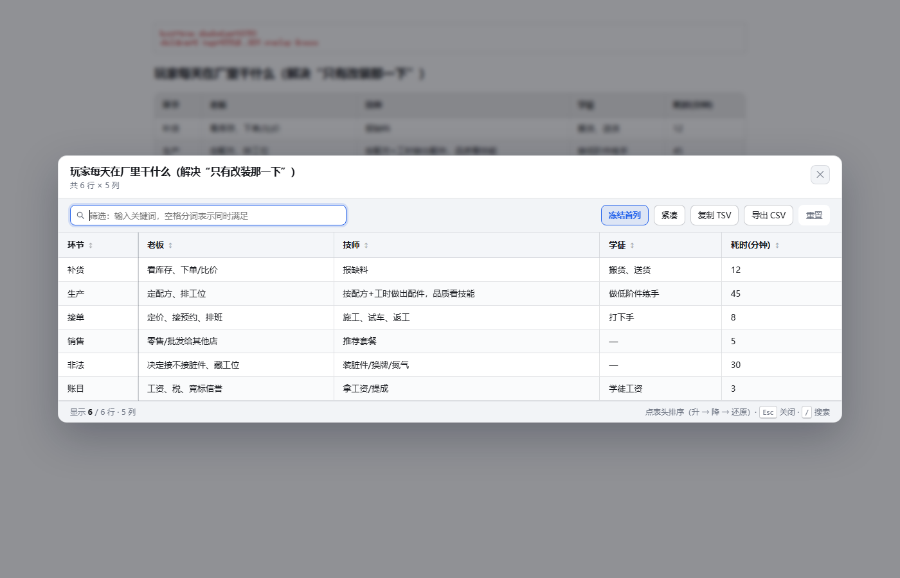
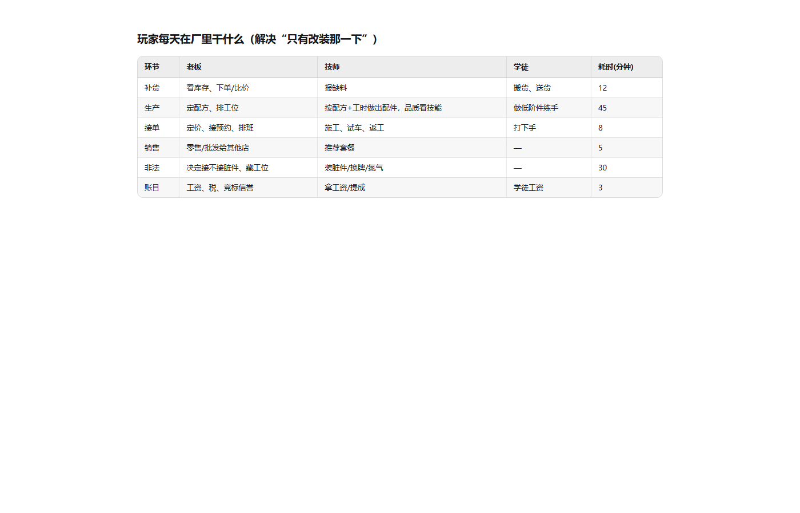
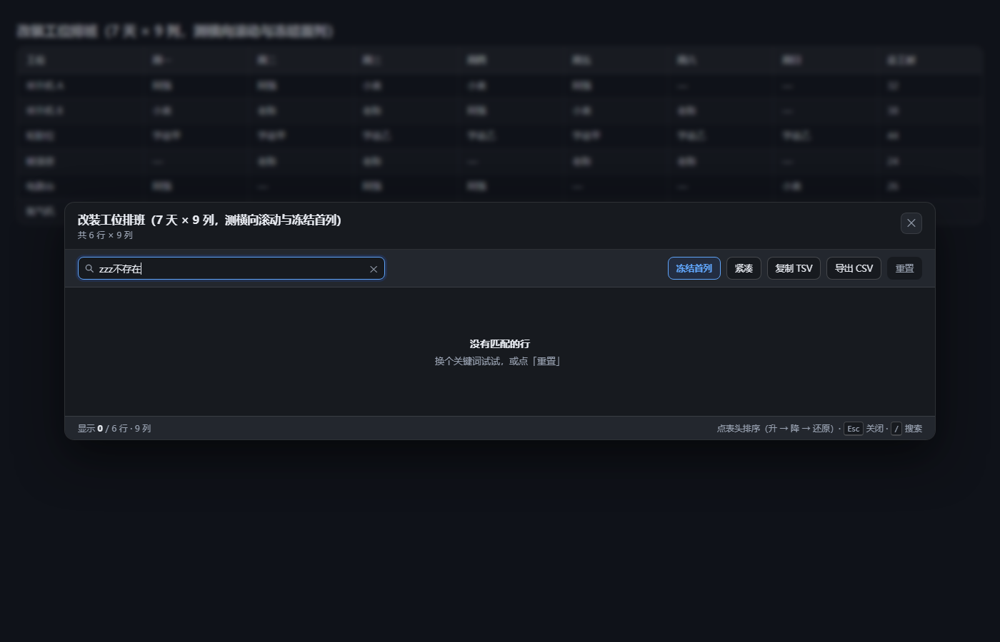

# dsh-table-lens · 表格放大镜

> 给 [DeepSeek Harness](https://github.com/deepseek-ai)（DSH）Web 界面用的一个小插件：
> **聊天里的 Markdown 表格，点一下就能变成可排序、可筛选、可冻结首列、可导出 CSV 的大表格。**



## 为什么

DSH 会把 Markdown 表格渲染出来，但受聊天宽度限制，列一多就挤在一起：字小、行密、没法排序、没法只看某几行。
这个插件把「看表格」这件事单独拿到一个全屏视图里，同时让聊天里的表格本身更好认。

## 功能

- **表格本体增强**：圆角边框、表头底色、斑马纹、整行悬停高亮，鼠标悬停有蓝色描边提示可点。
- **点一下放大**：点表格任意单元格弹出全屏大表，字号行距都为「看清楚」服务。
- **排序**：点表头循环「升序 → 降序 → 还原」；数字列按数值排（容忍千分位、货币符号、百分号、单位后缀），中文按拼音排。
- **筛选**：顶部搜索框，空格分词表示「同时满足」，例如 `学徒 轮胎`。
- **冻结首列**：左右滚动时第一列（环节 / 名称）一直贴在左边。
- **紧凑 / 宽松**两档行高。
- **复制 TSV**（直接粘进 Excel / 飞书表格）、**导出 CSV**（带 BOM，Excel 打开不乱码）。
- `Esc` 关闭，`/` 跳到搜索框，点遮罩空白处也能关。
- 跟随界面深浅色自动切换（按页面背景亮度判断，不依赖系统主题）。

<details>
<summary>更多截图</summary>

聊天里的表格（未打开放大层）：



筛选到 0 行时的空状态：



</details>

## 安装

需要 DSH 的 Web 界面（桌面端或 `dsh web`）。三种方式任选：

**1）插件页安装（最简单）**

打开 DSH → 左侧「插件」→ **添加插件** → 填入：

```
https://github.com/anymorisv/dsh-table-lens
```

**2）命令行安装**

```bash
dsh plugin add https://github.com/anymorisv/dsh-table-lens
# 或者：dsh plugin add github:anymorisv/dsh-table-lens
```

**3）本地源码安装**（改代码用）

```bash
git clone https://github.com/anymorisv/dsh-table-lens
dsh plugin add link:/绝对路径/dsh-table-lens
```

装好后**刷新一下 DSH 页面**（Ctrl+R）。没生效就在插件页把这个插件关一次再开一次，让它重新读取文件。

卸载：

```bash
dsh plugin remove dsh-table-lens
```

## 使用

不用记命令，也不用开面板：**看到表格，点它**。

想整段复制文字时照常拖选——拖选状态下点表格不会弹窗，不会抢你的操作。

## 兼容性

- 只在 **DSH Web 界面**里生效（桌面端和浏览器端都是 Web 界面，都可以）。
- 依赖 Chromium 的 `:has()` 选择器（Electron 30+ / 近两年的 Chrome、Edge 都没问题）。
- 只处理**有表头**的 `<table>`；代码块、布局用的表格不碰。
- 纯前端插件：不注册工具、不读写文件、不发网络请求。

## 它怎么做到的（不弄坏聊天界面）

- **不改写聊天区域的 DOM**：不包 wrapper、不搬节点、不往消息里塞按钮，只在 `document` 上挂一个捕获阶段的 `click`。
  这样流式渲染、React 重新 reconcile 时都不会和插件打架（包 wrapper 抢节点是这类插件最常见的翻车方式）。
- **放大层放在 Shadow DOM 里**：和 DSH 主题 CSS 完全隔离，既不会被主题改坏，也不会污染主题。
- 界面文案全部中文，代码里所有可调数值都用常量/注释标好，方便二次修改。

## 目录结构

```
dsh-table-lens/
├── client.js            # 全部功能：表格样式 + 放大层（原生 DOM + Shadow DOM）
├── index.js             # 宿主侧空壳，只为让 bundle 出现在配置树里
├── cordis.patch.yml     # bundle 挂载声明
├── locale/zh.json|en.json  # 插件页显示的名称与简介
├── icon.svg             # 插件图标
├── demo/index.html      # 本地演示页：不开 DSH 也能看效果
└── docs/                # 截图
```

## 本地演示

仓库里带了一个不用装 DSH 的演示页，验证样式和交互最方便：

```bash
# 在仓库根目录起一个静态服务器（file:// 下点开也行，但起服务器更方便调）
npx serve .
# 浏览器打开 http://localhost:3000/demo/
```

## 相关插件

同作者的另一个 DSH 插件：[**dsh-reader**](https://github.com/anymorisv/dsh-reader) —— 聊天正文排版增强 + 「标签：说明」清单自动变卡片，可在插件面板里开关。

## English

A tiny DSH Web plugin that upgrades Markdown tables: click any table to open a full-screen
lens with sorting, keyword filtering (space = AND), a frozen first column, density toggle,
TSV copy and CSV export. Tables in the transcript also get borders, zebra rows and hover
highlight. It never rewrites the chat DOM — one delegated `click` listener plus injected CSS,
with the lens isolated in a Shadow DOM.

Install: `dsh plugin add https://github.com/anymorisv/dsh-table-lens`, then refresh the page.

## License

MIT © 2026 Sigmund
